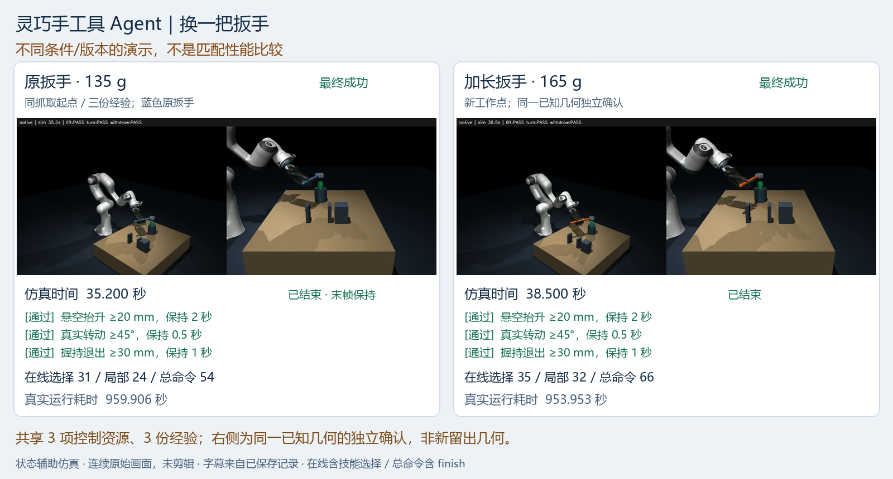

# Robot Agent Demo

**Let a coding agent operate a simulated dexterous hand, inspect the result, and save a traceable demonstration.**

[中文说明](README.zh-CN.md) · [Agent skill](.agents/skills/dexhand-tool-use/SKILL.md) · [Data and interfaces](docs/demonstrations.md) · [Recorded results](docs/results.md)

[](https://github.com/meishangming2000-a11y/robot-agent-demo/releases/download/v0.1.0/wrench-agent-demo.mp4)

This is the demonstration-generation stage of a larger agent-to-VLA experiment.
It provides a public Panda + Shadow Hand simulation, three tool tasks, bounded
robot actions, physical outcome checks, and source-backed experience reuse.
VLA training and automatic expert-data qualification are future stages.

```text
Language goal → coding agent → fresh RGB + measured state → bounded action
                    ↑                                       ↓
              reuse experience ← recorded outcome ← physics checks
```

## Run locally

Use Python 3.12 and working OpenGL. Windows is the validated platform.

```sh
git clone https://github.com/meishangming2000-a11y/robot-agent-demo.git
cd robot-agent-demo
python quickstart.py --task all
```

The first run installs an isolated `.venv`, downloads about 36 MB of pinned
public robot assets, and runs all three **engineering reference controllers**.
It prints an HTML report with videos, task gates, actions and measurements.
These offline references require no model account. Each run uses a new directory.

| Task | ID | Local reference video |
| --- | --- | --- |
| Pick up a hammer, press a passive spring button, withdraw | `hammer_button` | [Separate online-agent recording](media/demo.mp4) |
| Pick up a wrench, turn a passive nut ≥45°, withdraw | `wrench_turn` | [Reference recording](media/wrench.mp4) |
| Use passive spring forceps to transfer and release an object | `tweezers_transfer` | [Reference recording](media/tweezers.mp4) |

Choose one task with `python quickstart.py --task wrench_turn`.
The hammer video is a separately recorded online run, not the quickstart controller.

## Have your agent generate a demonstration

After quickstart, open this repository in Codex and give it this goal:

```text
Read .agents/skills/dexhand-tool-use/SKILL.md. Use the supplied experience to
complete one wrench_turn demonstration. Inspect each fresh observation and both
images before selecting an action. Continue until the episode ends. Return the
video, measured task gates, and separate online-agent/local-controller counts.
Retain failures and do not change the simulator or evaluator to obtain success.
```

The skill contains the complete procedure, allowed helpers, mailbox contract and
ordered experience records. Online operation uses your existing Codex setup.
The agent interprets the goal and chooses actions; it can explicitly invoke a
published local withdrawal controller. Both kinds of actions are recorded.
Physics pauses while the agent deliberates. This is **simulator-state-assisted
operation**, with RGB, geometry and contact information.

The supported embodiment is Panda + Shadow Hand. Changing the hand or inventing
a new task still requires a scene, control mapping and task contract; arbitrary
robot/task generation has not been demonstrated.

## What a run saves

- `steps/`: fresh requests, two RGB views, actions and execution results.
- `samples.jsonl`: measured physical task traces for independent recomputation.
- `summary.json`, `metadata.json`, `experience.json`: outcome, provenance and reusable experience.
- `episode.mp4` and `report.html`: continuous video and human-readable review.

Native agent records contain boundary observations and high-level commands.
The separate synchronized collector records dense applied controls for the
engineering references. [Their different semantics matter for future training](docs/demonstrations.md).
Task success alone does not qualify every sample as expert data.

## Evidence and limitations

The retained longer/heavier-wrench confirmation completed the task with 35 online
choices and 32 local actions; final nut rotation was 65.149°. It was one known
geometry with a fresh actor, not an unseen-tool benchmark. Earlier procedural
nonacceptance and an interrupted attempt remain in the [results](docs/results.md).
Experience reuse has not yet established an efficiency improvement.

This release contains no VLA weights or training claim. All results are simulation
results. The forceps uses a passive-leaf approximation and temporary lower-tip
support during placement. [Physical contracts](docs/task-contract.md) specify the
task gates; force/penetration diagnostics and stronger wrench quality gates have
their own scope.

## Check and extend

Use `.venv/bin/python` instead of `.venv/Scripts/python.exe` on Unix:

```sh
.venv/Scripts/python.exe tools/evaluate_episode.py runs/YOUR-RUN/wrench_turn
.venv/Scripts/python.exe -m pip install -e ".[test]"
.venv/Scripts/python.exe -m pytest tests -q
```

[Contributing](CONTRIBUTING.md) · [Release validation](docs/validation.md) · [Robot provenance](docs/robot-provenance.md)

Original code, task fixtures and documentation: [MIT](LICENSE).
Downloaded Panda/Shadow assets retain [Apache-2.0 notices](THIRD_PARTY_NOTICES.md).
The runtime package remains named `dexhand-agent` to preserve existing commands.
