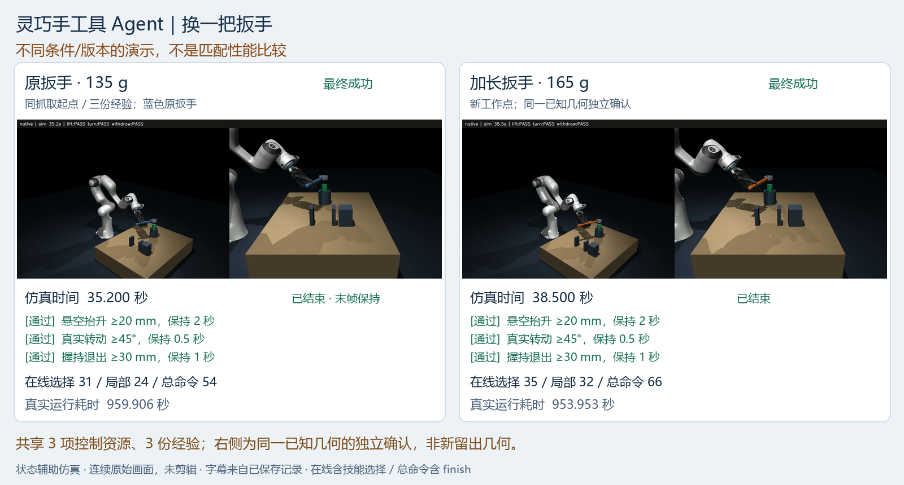

# Robot Agent Demo

**让 coding agent 操作仿真灵巧手，检查物理结果，并保存可追溯的操作示范。**

[English](README.md) · [Agent 技能](.agents/skills/dexhand-tool-use/SKILL.md) · [数据接口](docs/demonstrations.md) · [结果与边界](docs/results.md)

[](https://github.com/meishangming2000-a11y/robot-agent-demo/releases/download/v0.1.0/wrench-agent-demo.mp4)

这是“agent 生成示范 → 数据验收 → 训练 VLA”项目的前半部分。首版开放执行环境、三工具任务、经验复用、录像和独立物理验收。VLA 训练与专家数据自动筛选属于后续阶段。

## 先运行本地演示

需要 Python 3.12 和可用的 OpenGL，当前已验证 Windows。

```sh
git clone https://github.com/meishangming2000-a11y/robot-agent-demo.git
cd robot-agent-demo
python quickstart.py --task all
```

首次运行自动建立独立环境、下载约 36 MB 的固定版本公开机器人资产，再运行锤子按按钮、扳手转螺母、弹簧镊夹物搬运三项任务。最后输出包含录像和物理指标的 HTML 报告。

**这个命令运行工程参考控制器，不调用在线 agent。** 只运行扳手可以使用 `python quickstart.py --task wrench_turn`。

## 让 agent 自己生成 demo

完成环境准备后，在 Codex 中打开这个仓库，输入：

```text
读取 .agents/skills/dexhand-tool-use/SKILL.md，用已提供的来源经验完成一次扳手操作示范。
每次先查看新观测和两幅图像，再选择动作，持续处理到回合结束。
返回录像、物理验收和在线选择/局部控制动作计数。保留失败记录，不修改物理环境或验收器来获取成功。
```

技能已提供启动命令、三份有来源的经验、允许调用的程序和逐步记录要求。agent 根据新观测选择动作，也可以明确选择调用局部退出控制程序；二者分别计数。在线操作使用你已有的 Codex 登录，思考时仿真暂停。

当前本体是公开 Panda 机械臂 + Shadow 手。输入包含 RGB、仿真状态、几何和接触信息，属于状态辅助操作。更换任意手或新增任意任务，还需要实现对应场景、控制映射与验收条件。

## 保存什么，已经证明什么

每个回合保存双视角图像、动作和结果、物理采样、验收摘要、经验、录像及 HTML 报告。另有同步采集器为工程参考程序保存 RGB、完整状态和实际逐时刻控制；这两种记录不能混为一谈。[数据说明](docs/demonstrations.md)。

已有加长加重扳手确认回合通过：35 次在线选择、32 次局部动作，螺母最终转动 65.149°。它是已知几何上的一次新 actor 确认，不构成广泛泛化或专家数据质量证明；原过程未接受和中断记录仍保留。[结果与限制](docs/results.md)。

当前没有已训练 VLA、真机、任意新工具自主生成或经验复用提高效率的结论。弹簧镊是声明的被动弹片近似，放置时会由下尖短暂承托物体。

原创代码采用 [MIT](LICENSE)，公开机器人资产保留 [Apache-2.0 许可](THIRD_PARTY_NOTICES.md)。底层 Python 包仍叫 `dexhand-agent`，原有运行命令保持可用。
